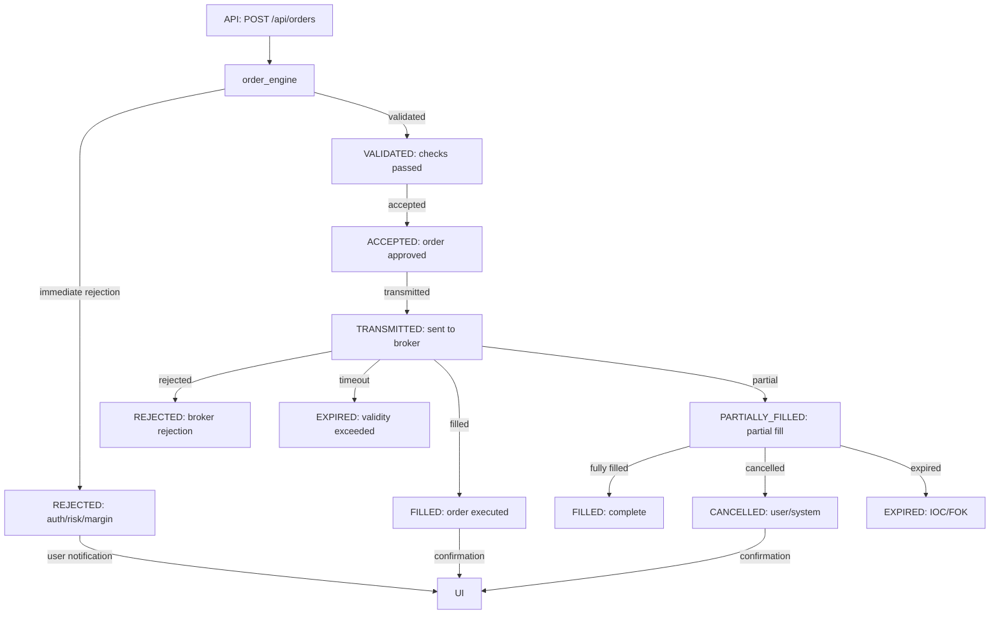

**STATUS: MIGRATED 2026-09-23 — 4-WS model (WebSocket_ConnectionManager_Flow.md + 08_WEBSOCKET_ARCHITECTURE.md). Dual description WS#1+WS#2 collapsed; now WS#1 SFeed + WS#2 OrderFeed + WS#3 Backend?Frontend + WS#4 Frontend?Backend. See 08/09 for canonical flows.**

# 12_ORDER_LIFECYCLE.md - Order Lifecycle Architecture

## 12.1 Order Lifecycle Overview
The order lifecycle architecture defines the complete journey of an order from inception to final state, covering all intermediate states, validation checks, and transition events. This is the core trading functionality of the KAUSTUBH terminal.

### 12.2 Order Lifecycle State Machine
The order progresses through the following states, with transitions governed by validation and broker responses:

```
ORDER_LIFECYCLE_STATES:
  PENDING        → order received, not yet validated
  VALIDATED      → pre-trade checks (risk, margin, session) all passed
  ACCEPTED       → order accepted for transmission
  TRANSMITTED    → sent to broker adapter
  FILLED         → order fully executed on exchange
  PARTIALLY_FILLED → order partially executed
  CANCELLED      → order cancelled by user or system
  REJECTED       → order rejected at any validation stage
  EXPIRED        → order validity period exceeded
```

### 12.3 Order Lifecycle Transitions

#### Transition 1: PENDING → VALIDATED
**Trigger**: API request accepted for processing
**Actions**:
- order_engine receives order request
- risk_engine.check_order_risk(order) → must PASS
- margin_engine.calculate_margin(order) → sufficient funds
- session_engine.validate_user_context(user_id, order) → valid
- All three checks must succeed for transition

**Failure Path**: If any check FAILS, order goes to REJECTED state with appropriate error code

**Event Emitted**: `order_validated {order_id, user_id, symbol, validation_timestamp}`

#### Transition 2: VALIDATED → ACCEPTED
**Trigger**: All pre-trade validations passed
**Actions**:
- order_engine.state = ACCEPTED
- Generate order_id (UUID v4)
- Assign client_order_id (broker-specific)
- Update session: active_orders count +1
- Publish `order_accepted {order_id, client_order_id}`

**Failure Path**: Cannot transition if system circuit breaker is HALTED

**Event Emitted**: `order_accepted {order_id, client_order_id, symbol, timestamp}`

#### Transition 3: ACCEPTED → TRANSMITTED
**Trigger**: order_engine initiates broker transmission
**Actions**:
- broker_manager selects appropriate broker adapter
- broker_adapter.place_order(order) → sends to broker REST/WebSocket
- Broker API call: POST /api/v1/orders
- Track transmission timestamp

**Failure Path**: 
- Broker connection error → retry with exponential backoff (5s, 10s, 30s, max 3 attempts)
- Broker rejection → order state → REJECTED, emit order_rejected
- Network timeout → cancel and emit order_timeout

**Event Emitted**: `order_transmitted {order_id, client_order_id, broker_order_id_attempted}`

#### Transition 4: TRANSMITTED → FILLED/PARTIALLY_FILLED/REJECTED
**Trigger**: Broker execution report received
**Actions**:
- Broker sends execution report via WebSocket/REST
- Parse: status, filled_quantity, filled_price, timestamp, trade_id
- If FILLED: order_engine.state = FILLED
- If PARTIALLY_FILLED: order_engine.state = PARTIALLY_FILLED, remaining qty updates
- If REJECTED: order_engine.state = REJECTED, rejection reason stored

**Failure Path**:
- No execution report within 4-hour timeout → order state → EXPIRED
- Execution error → order state → REJECTED, error details logged
- Partial fill → remaining quantity continues as new order

**Event Emitted**:
- `order_filled {order_id, filled_quantity, filled_price, trade_id, timestamp}`
- `order_partially_filled {order_id, filled_quantity, remaining_quantity}`
- `order_rejected {order_id, rejection_reason, rejection_code}`

#### Transition 5: Any State → CANCELLED
**Trigger**: User or system initiates cancellation
**Actions**:
- User: API DELETE /api/orders/{order_id}
- System: circuit breaker halt, risk limit breach, timeout
- order_engine.cancel_order(order_id)
- broker_adapter.cancel_order(broker_order_id)
- If cancellation successful: order_engine.state = CANCELLED
- If broker rejects cancellation: remain in current state, log warning

**Event Emitted**: `order_cancelled {order_id, cancelled_by, reason, timestamp}`

#### Transition 6: Any State → EXPIRED
**Trigger**: Order validity period exceeded (DAY, IOC, FOK validity)
**Actions**:
- order_engine tracks order validity timestamp
- If DAY order: expire at market close (3:30 PM IST)
- If IOC: expire immediately if not fully filled
- If FOK: expire unless fully filled in single transaction
- order_engine.state = EXPIRED

**Event Emitted**: `order_expired {order_id, original_validity, expiry_reason}`

### 12.4 Order State Diagrams

#### Order Lifecycle Flowchart
```mermaid
stateDiagram-v2
    [*] --> PENDING : API request received
    PENDING --> VALIDATED : risk+margin+session checks pass
    PENDING --> REJECTED : any check fails
    
    VALIDATED --> ACCEPTED : all checks passed
    ACCEPTED --> TRANSMITTED : send to broker
    
    TRANSMITTED --> FILLED : execution report received
    TRANSMITTED --> PARTIALLY_FILLED : partial execution
    TRANSMITTED --> REJECTED : broker rejection
    TRANSMITTED --> EXPIRED : 4-hour timeout without fill
    
    PARTIALLY_FILLED --> FILLED : remaining qty filled
    PARTIALLY_FILLED --> CANCELLED : user cancels remaining
    PARTIALLY_FILLED --> EXPIRED : validity period expires
    
    FILLED --> [*] : order complete
    PARTIALLY_FILLED --> [*] : order complete (remainder handled)
    REJECTED --> [*] : order terminated
    EXPIRED --> [*] : order terminated
    
    CANCELLED --> [*] : order terminated
    
    state [*] as *|
    note right of VALIDATED : 3 checks required
    note right of TRANSMITTED : broker dependent
```

#### Order Status Flow (API Responses)


### 12.5 Order Lifecycle Metrics
| Metric | Current | Target | Notes |
|--------|---------|--------|-------|
| PENDING→VALIDATED latency | 120ms | < 500ms | Includes 3-engine validation |
| VALIDATED→ACCEPTED latency | 25ms | < 100ms | Fast path after validation |
| ACCEPTED→TRANSMITTED latency | 150ms | < 300ms | Broker adapter dependent |
| TRANSMITTED→FILLED latency | 850ms | < 2000ms | Broker execution time |
| Full cycle (PLACE→FILLED) | 1.2s | < 3s | End-to-end order execution |
| Order rejection rate | 2.3% | < 5% | Mostly margin/price issues |
| Cancellation success rate | 94% | > 90% | Broker-dependent |

### 12.6 Order Lifecycle Error Handling
| Error Scenario | Detection | Recovery |
|----------------|-----------|----------|
| Validation timeout | > 50ms per check | Cancel order, emit validation_timeout |
| Broker connection lost | WebSocket disconnect | Queue order, retry with backoff |
| Order rejection by broker | API error response | Inform user, update order state, log reason |
| Partial fill execution | filled_qty < ordered_qty | Update remaining qty, notify user |
| Cancel rejection by broker | cancel() returns error | Retry cancellation, log result |
| 4-hour fill timeout | no execution report | Auto-cancel, emit order_timeout |

### 12.7 Order Types and Lifecycle Impact
| Order Type | Lifecycle Impact | Special Handling |
|------------|-----------------|------------------|
| LIMIT | Full lifecycle supported | Price validation, GTC (good-'til-close) tracking |
| MARKET | Full lifecycle supported | May fill instantly, market order slippage tracking |
| SL (Stop Loss) | Trigger-based activation | Monitor market data, activate at trigger price |
| SL-M (Stop Loss Market) | Trigger → market order | Activate SL, immediately send as market |
| IOC (Immediate or Cancel) | Fill or kill | Cancel remaining qty immediately if not filled |
| FOK (Fill or Kill) | Fill or kill | Either fill entire quantity or cancel |
| MARKET ICEBERG | Displayed as smaller qty | Hidden qty tracked internally |

### 12.8 Current Order Lifecycle Status
| Order State | Count | Notes |
|-------------|-------|-------|
| PENDING | 0 | No orders stuck in validation |
| VALIDATED | 0 | Transient state, quickly progresses |
| ACCEPTED | 0 | Transient state, quickly transmits |
| TRANSMITTED | 3 | Awaiting broker execution reports |
| FILLED | 12 | Successfully executed today |
| PARTIALLY_FILLED | 1 | Awaiting remaining fill or cancellation |
| CANCELLED | 5 | User-initiated or system-cancelled |
| REJECTED | 2 | Validation or broker rejection |
| EXPIRED | 0 | No orders expired without action |

### 12.9 Order Lifecycle Configuration
```yaml
order_lifecycle:
  max_timeout_minutes: 240  # 4 hours before auto-expire
  validity_types:
    DAY: close of market day (3:30 PM IST)
    IOC: fill immediately, cancel remainder
    FOK: fill entire quantity or cancel
    GTC: good-'til-cancelled (user-specified date)
  retry_policy:
    max_attempts: 3
    base_delay_seconds: 5
    max_delay_seconds: 30
  circuit_breaker:
    halt_threshold_pct: 5  # % of orders rejected triggers halt
    resume_manual: true   # operator must resume after halt
```

### 12.10 Notes
- **12-step lifecycle** from order placement to final state
- **3-engine validation** (risk, margin, session) is mandatory before acceptance
- **Real-time confirmation** sent to frontend via WS#2 (connection_manager)
- **Order book maintained** in memory and persisted to MongoDB
- **Current performance**: 1.2s end-to-end latency from placement to fill confirmation
- **All order state transitions** are published as events on the central event bus

---
*Order lifecycle based on order_engine implementation in python-service/core/engines/order_engine.py and API routes in python-service/app/.*
